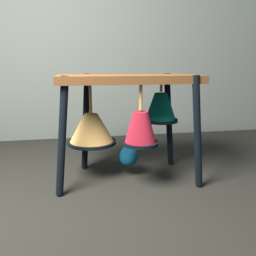
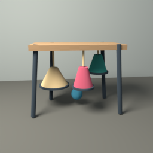
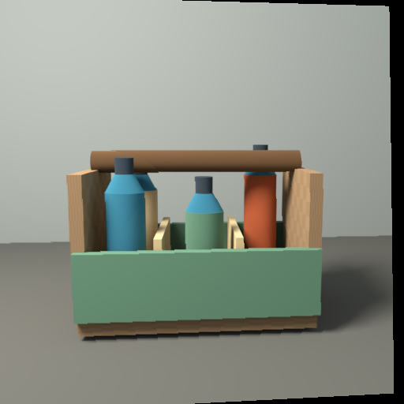
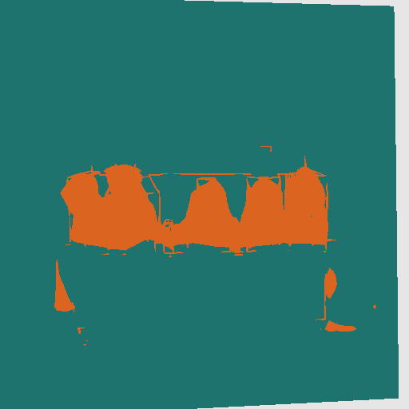

# Evidence Lens

Evidence Lens estimates where a synthesized view is likely to disagree with an independent image from the same camera. Its CPU scorer reads calibrated source images and predicted RGB, opacity and expected camera depth. It returns a continuous risk map and a low, high or unknown state for each target pixel. Researchers can compare the maps with Blender references through a separate evaluation command.

## Run the two- and four-image models

The multi-source release includes four trained risk models and both reconstructions of an authored bell cage. The same six cameras view each reconstruction. The default multi-source logistic model uses NumPy and Pillow. The two DINOv2 models add PyTorch for CPU inference. [Download v0.3.0-rc.1](https://github.com/wany614/evidence-lens/releases/tag/v0.3.0-rc.1) · [Install and score a target](docs/releases/v0.3.0-rc.1/README.md) · [Weights, training and measured CPU cost](docs/releases/v0.3.0-rc.1/MODEL_CARD.md)

| One of four source images | Reconstructed target | Independent target reference |
| --- | --- | --- |
|  |  |  |

In this target, 5,149 of 65,536 pixels exceed mean absolute RGB error 0.05. The comparison board shows where these errors occur and how each scorer responds when it receives one, two or all four images from the same reconstruction. This example was selected by family and view before scoring. [Open the full comparison board](examples/offset-bell-cage/four-method-comparison-v01.png) · [Camera, source and figure provenance](examples/offset-bell-cage/README.md)

On the four held-out families, the family-equal RGB error fraction changed from 10.66% with two source images to 6.90% with four. With four sources, common-domain AP was 0.704 for MS-L1, 0.651 for MS-frozen and 0.665 for MS-ft. The default was selected on development data. [Held-out results, operating points and denominators](docs/results/multisource-confirmation.md) · [Mac, Windows and Linux public CPU verification](docs/verification/v0.3.0-rc.1/README.md) · [Open the default risk and state maps](examples/offset-bell-cage/README.md#default-model-output-from-the-public-download)

The frozen models were also evaluated on one held-out physical object from the official DTU SampleSet. On six target views with four source cameras, 91.00% of comparable pixels exceeded RGB MAE 0.05. Default MS-L1 reached common-support AP 0.9109 at a view-equal error prevalence of 0.8989. It called 0.60% of the crop low risk, and 1,958 of those 2,378 pixels exceeded the error tolerance. This is a single-object test under known calibration. [Full external results and denominators](docs/results/dtu-external/README.md) · [Current state and timing](docs/current-state.md) · [Reproducibility matrix](docs/reproducibility-matrix.md)

## Single-image models

The single-image release includes a lightweight logistic model (L1-full), a DINOv2 ViT-S/14 with a trained risk head (L2-frozen), and a supervised model that also updates the last two transformer blocks and final LayerNorm (L2-vision-ft). All three score on a CPU. The source checkout installs the NumPy and Pillow path with `python -m pip install .`. The optional visual path adds PyTorch and safetensors. [Run L1 with only NumPy and Pillow](docs/releases/v0.2.0-rc.1/README.md#run-the-default-l1-model-with-numpy-and-pillow)

| Observed image | Predicted first target | Measured RGB error | Fine-tuned risk decision |
| --- | --- | --- | --- |
|  |  |  |  |

The independently runnable 512 × 512 example uses an authored two-metre plane and a Blender bottle carrier. Across its six target views, 16.44% of comparable pixels exceeded mean absolute display-sRGB error 0.05. The fine-tuned model marked 82.83% of reference-valid pixels low risk. Of comparable pixels in that group, 5.75% exceeded the error threshold. The formal single-image study uses SHARP and gsplat. [Native example and origins](examples/native-plane-control/README.md) · [Model card](docs/releases/v0.2.0-rc.1/MODEL_CARD.md)

## Run the visual models

Download the CPU ZIP and checksum list from the pre-release, check the ZIP, and extract it into a new directory. With Python 3.11 or 3.12, run this command from the extracted directory. [v0.2.0-rc.1 downloads](https://github.com/wany614/evidence-lens/releases/tag/v0.2.0-rc.1) · [Verified public CPU replay with pinned downloads](docs/verification/v0.2.0-rc.1/README.md)

```sh
python3 -I -B smoke.py --output ../vision-plane-result
```

Windows PowerShell accepts `py -3.12 -I -B smoke.py --output ..\vision-plane-result`. The first run installs the CPU dependencies in a temporary environment. The result contains six seven-method score files and 36 risk and state PNGs. To reproduce the native example above, also download the public-plane-512 attachment and follow the native-case command. Its deployment directory contains the source image, cameras and seven predicted views. Blender references have their own independent evaluation command. [Scoring commands and output](docs/releases/v0.2.0-rc.1/README.md) · [Verify the public downloads and reproduce the evaluation](docs/releases/v0.2.0-rc.1/REBUILD.md)

## What changed with visual fine-tuning

The study fitted the models on 28 training families and selected thresholds and learning rates on eight development families. All eight formal neural fits were retained. Independent tensor checks confirmed that supervised training changed 3,551,228 pretrained scalars in the primary fine-tuned model. Each visual deployment weighs 88,301,188 bytes in FP32. On an arm64 Mac, the fine-tuned model took 0.645 seconds to produce its first complete 512 × 512 score file and 0.228 seconds per view at the warm 95th percentile. The matched three-seed development AP difference for fine-tuning versus freezing averaged −0.0073 with sample standard deviation 0.0158. **L1-full remains the default** under the rule frozen before the eight new confirmation families were opened. [Weights, training evidence and measured cost](docs/releases/v0.2.0-rc.1/MODEL_CARD.md) · [Study and selection protocol](protocol/stage2-training-v1.json)


## Confirmation on held-out families

Across eight newly held-out families, native-input common-domain AP was **0.819 for L1-full**, **0.881 for L2-frozen** and **0.899 for L2-vision-ft**. The four families used in the historical regression check are reported separately. The default was selected on development data before these measurements. [Complete results, including R1 and Q1](docs/results/vision-confirmation.md) · [Risk–coverage curves for every family](examples/vision-study-figures/README.md)

## First-stage logistic baseline

The fitted L1-full and L1-geometry models, preprocessing, schema and thresholds occupy **12,387 bytes** of JSON. On the four families originally held out, L1-full reached family-equal average precision **0.804** for RGB error and L0 reached **0.402** on the same scoreable pixels. At its frozen threshold, L1-full marked **62.71%** of reference-valid pixels low risk. **11.03%** of those pixels had an actual RGB error. A raw-pixel replay reproduced the operating counts and scores. The separate auxiliary depth comparison found **1.146 m** mean absolute error and **99.40%** above tolerance. The research preview applies to nearby views of opaque synthetic studios with one generator. [Stage-one evidence and limits](docs/phase1/README.md) · [Original study tables](docs/results/README.md)

| Single input | Example projected view | L1-full risk | Low, high or unknown |
| --- | --- | --- | --- |
|  |  |  |  |

The illustration comes from a project-authored textured-plane adapter. Formal study results use SHARP and gsplat. The drum-kit case includes the original Blender input, the first held-out target reference and its measured errors. [Runnable plane example](examples/tabletop-plane/README.md) · [Formal drum-kit case](examples/heldout-drum/README.md)

### Run the original L1 bundle

Download the CPU ZIP and its SHA-256 sidecar from the **v0.1.1-rc.3** pre-release. The ZIP contains the two fitted L1 models, the CPU wheel, an original source image, calibrated cameras, seven predicted views and reference scores for all six targets. Verify the ZIP against the sidecar, extract it and run this command inside the extracted folder with Python 3.11 or newer. [Release and downloads](https://github.com/wany614/evidence-lens/releases/tag/v0.1.1-rc.3)

```sh
python3 -I smoke.py --output ../evidence-lens-grade
```

On Windows, use `py -3 -I smoke.py --output ..\evidence-lens-grade`. The command creates a clean environment and installs the CPU wheel with NumPy and Pillow. Open the first target's risk and state PNGs under the output's `maps/` directory. Each run needs a fresh output directory. The included 128 × 128 textured plane checks numerical parity with the original deployment example. The scientific evaluation uses six 512 × 512 target views per family. To install the CPU implementation from a checkout, use `python -m pip install .`. [RC installation instructions](docs/releases/v0.1.1-rc.3/README.md) · [Prediction contract](docs/cpu-scoring.md)

### First-stage study and tested scope

The study uses 24 procedural families of static, opaque objects. Blender 4.5.16 LTS Cycles on an arm64 Mac rendered reference RGB, positions and camera-axis depths. SHARP commit `aed6527499ef91cba3b54c18d49a870f25947190` with the checkpoint starting `94211a75198c47f6` produced one Gaussian scene per input. On Windows 11 with an RTX 3060 Laptop, gsplat 1.5.3 rendered the source and six nearby targets using expected optical-axis depth in metres. The first engineering input produced 1,179,648 Gaussians in a 14.81-second forward pass. CPU installation checks and the GPU geometry probes have separate receipts. The baseline measurements use the frozen RGB label of mean absolute display-sRGB error strictly greater than 0.05. [Deployment validation and scientific case scope](docs/phase1/README.md)

L1-full and L1-geometry are L2-regularized logistic regressions fitted on the same 393,216 sampled target pixels. The 16 training families are the independent training units. Four separate development families set the low-risk operating thresholds. Four further families were held out until the model and metric code were frozen. The experiment covers baseline inputs, half-resolution inputs and a round-trip of only the Gaussian colour coefficients through binary16. Real photographs, transparent materials, moving scenes and other learned generators fall outside the measured scope. The candidate smoke records the exact operating system, wheel and dependencies in a separate receipt. [Candidate model card](docs/releases/v0.1.1-rc.3/MODEL_CARD.md) · [Study protocol](protocol/study-v1.json)

The engineering tabletop remains a reproducible failure case. Its six targets contained 416,365 RGB errors among 1,572,864 comparable pixels. L0 flagged 27.82% of those errors. Among pixels labelled low risk, 21.54% exceeded the RGB error threshold. That family belongs to training. It is reported separately from held-out performance.

## Reproduce the research

The authored recipes, cameras, family split, feature specification, labels and fitting protocol are in the repository. Follow the reconstruction guide to make a new research store, render a family, run the Windows worker and fit a replication model. Full original arrays, Gaussian files, logs and the live database are kept in the research archive. Public run IDs, manifests and checksums identify their origins. The scoring entry point takes only source and prediction inputs. The independent evaluation entry point reads target references.

- [Rebuild from a fresh checkout](docs/rebuild-study.md) describes environment setup, the single-family pilot and a separate full replication.
- [Module inputs, outputs and permissions](docs/data-contract.md) identifies each producer and its permitted data.
- [Blender reference validation](docs/blender-reference.md) and [Windows GPU acquisition](docs/windows-worker.md) document the coordinate and rendering conventions.
- [Recording, transfer and restore](docs/recording.md) documents immutable attempts, failed runs, local indexing and archive checks.
- [L1 training](docs/l1-training.md) and [formal evaluation](docs/formal-evaluation.md) specify sampling, family folds, thresholds, denominators and common-mask comparisons.
- To reproduce the multi-source study, start with its [data and scoring protocol](docs/stage3-risk.md), [neural training guide](docs/stage3-neural.md) and [release rebuild instructions](docs/releases/v0.3.0-rc.1/REBUILD.md).
- [License and provenance inventory](docs/licenses.md) lists separate terms for original code, fitted parameters, example data and third-party research software.

## License and attribution

Credit Evidence Lens to **wany614**. The original software, configurations and grantable model parameters use Apache-2.0. The visual models retain Meta’s DINOv2 attribution and license. Original writing, images and grantable research data use CC BY 4.0. Public assets carry a file-specific license record. [Asset and training lineage](docs/licenses.md) · [Single-image model rights](docs/vision-rights.md) · [Multi-source model and example rights](docs/multisource-rights.md) · [Software license](LICENSE) · [Citation](CITATION.cff)
