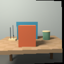

# Evidence Lens

Evidence Lens estimates where a nearby synthesized view is likely to disagree with the scene that produced the input image. Its CPU scorer reads one source image, calibrated cameras and a generator's predicted RGB, opacity and expected camera depth. It produces continuous risk and low, high or unknown decisions for every target pixel.

The fitted L1-full and L1-geometry models, feature schema and frozen thresholds occupy **12,387 bytes** of JSON. They were trained on 16 authored Blender scene families. On four new families, using the 512×512 baseline condition, their family-equal average precision was **0.804** and **0.771** respectively. The deterministic L0 baseline reached **0.402** on the same scoreable pixels. The registered outcome is mean absolute display-sRGB error strictly above 0.05. Six views from the same family share a scene and camera setup. [Held-out results, curves and per-family tables](docs/results/README.md)

| Single input | Example projected view | L1-full risk | Low, high or unknown |
| --- | --- | --- | --- |
|  |  |  |  |

The illustration comes from a project-authored textured-plane adapter. Quantitative study results use SHARP and gsplat. [Example inputs and provenance](examples/tabletop-plane/README.md)

## Run the model on a CPU

The v0.1.0 package is a private release candidate pending the owner’s repository and license selections.

The versioned model ZIP contains a Python wheel, coefficients, preprocessing parameters, camera calibration, seven small prediction arrays, a numerical expectation and its checksums. Use the commands below in the extracted ZIP. The base package requires Python 3.11 or later, NumPy and Pillow. [Versioned installation and verification guide](docs/releases/v0.1.0/README.md)

```sh
python -m venv .venv
. .venv/bin/activate
python -m pip install ./distribution/evidence_lens-0.1.0-py3-none-any.whl
python -I -m evidence_lens.l1_demo grade --bundle . --manifest-sha256 bc6c3cc8580451deab569b6778042c92d0b93180d181d20d2ba5f896b2e497cc --output grade
python -I -m evidence_lens.score_maps --scores grade/scores --output maps
```

On Windows, create the environment with `py -3 -m venv .venv` and replace `python` in each subsequent command with `.\.venv\Scripts\python.exe`. The versioned guide gives the complete PowerShell commands. Open `maps/v01-risk.png` and `maps/v01-state.png`. All six targets have separate NPZs, PNGs and state counts. Scores lie between 0 and 1. The frozen operating rule marks finite scores below the threshold as low risk. Grey marks unknown pixels. The plane example has no target labels and exercises the scoring interface. Accuracy measurements come from the held-out SHARP views. To install the CPU code from a source checkout, use `python -m pip install .`. [Prediction bundle contract](docs/cpu-scoring.md)

## Study and tested scope

The study uses 24 procedural families of static, opaque objects. Blender 4.5.16 LTS Cycles on an arm64 Mac rendered reference RGB, positions and camera-axis depths. SHARP commit `aed6527499ef91cba3b54c18d49a870f25947190` with the checkpoint starting `94211a75198c47f6` produced one Gaussian scene per input. On Windows 11 with an RTX 3060 Laptop, gsplat 1.5.3 rendered the source and six nearby targets using expected optical-axis depth in metres. The first engineering input produced 1,179,648 Gaussians in a 14.81-second forward pass. Two clean Mac CPU environments scored the same six targets. With CPython 3.12.16, NumPy 2.5.5 and Pillow 12.3.0, every finite score matched the recorded value exactly. With CPython 3.11.18, NumPy 1.26.4 and Pillow 11.0.0, the largest absolute score difference was 1.19 × 10⁻⁷. A separate Windows 11 (25H2, AMD64) CPU installation used CPython 3.11.5, NumPy 2.4.6 and Pillow 12.3.0. All six targets and five methods reproduced the original scores exactly on Windows. All three installations agreed on valid pixels and decisions.

L1-full and L1-geometry are L2-regularized logistic regressions fitted on the same 393,216 sampled target pixels. The 16 training families are the independent training units. Four separate development families set the low-risk operating thresholds. Four further families were held out until the model and metric code were frozen. The experiment covers baseline inputs, half-resolution inputs and a round-trip of only the Gaussian colour coefficients through binary16. Real photographs, transparent materials, moving scenes and other learned generators fall outside the measured scope. Linux CPU validation is pending. [Model card and per-family outcomes](docs/releases/v0.1.0/MODEL_CARD.md) · [Study protocol](protocol/study-v1.json)

The engineering tabletop remains a reproducible failure case. Its six targets contained 416,365 RGB errors among 1,572,864 comparable pixels. L0 flagged 27.82% of those errors. Among pixels labelled low risk, 21.54% exceeded the RGB error threshold. That family belongs to training. It is reported separately from held-out performance.

## Reproduce the research

The authored recipes, cameras, family split, feature specification, labels and fitting protocol are in the repository. Follow the reconstruction guide to make a new research store, render a family, run the Windows worker and fit a replication model. Full original arrays, Gaussian files, logs and the live database are kept in the research archive. Public run IDs, manifests and checksums identify their origins. The scoring entry point takes only source and prediction inputs. The independent evaluation entry point reads target references.

- [Rebuild from a fresh checkout](docs/rebuild-study.md) describes environment setup, the single-family pilot and a separate full replication.
- [Module inputs, outputs and permissions](docs/data-contract.md) identifies each producer and its permitted data.
- [Blender reference validation](docs/blender-reference.md) and [Windows GPU acquisition](docs/windows-worker.md) document the coordinate and rendering conventions.
- [Recording, transfer and restore](docs/recording.md) documents immutable attempts, failed runs, local indexing and archive checks.
- [L1 training](docs/l1-training.md) and [formal evaluation](docs/formal-evaluation.md) specify sampling, family folds, thresholds, denominators and common-mask comparisons.
- [License and provenance inventory](docs/licenses.md) lists separate terms for original code, fitted parameters, example data and third-party research software.
