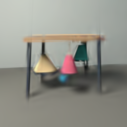
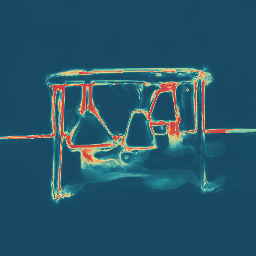
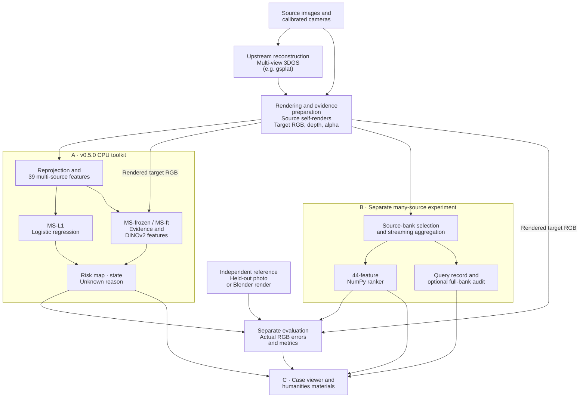
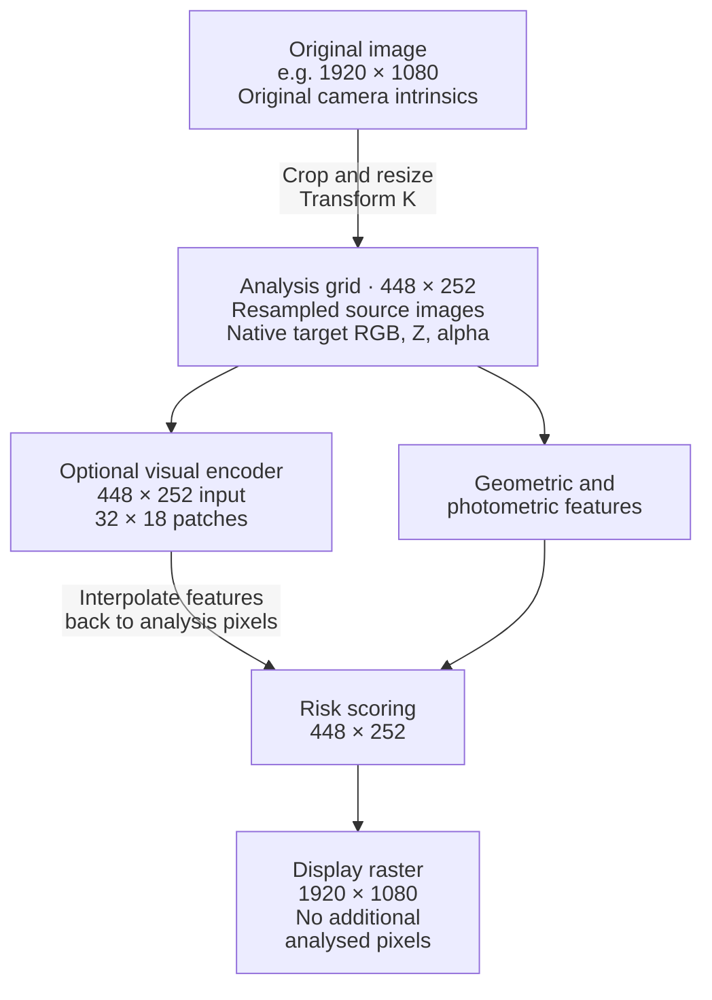

# Evidence Lens

**A convincing 3D image is not necessarily a well-supported one.**

Evidence Lens is an open-source, interdisciplinary research project exploring evidence and reliability in 3D reconstruction. It asks where a newly rendered view is likely to disagree with an independent image of the same viewpoint, and which source observations are available to support that assessment.

The CPU tools use calibrated source images, source-view renders and predicted colour, opacity and camera-axis depth. They estimate photometric error risk and record the evidence consulted. They do not establish the authenticity of a depicted object or certify that a reconstruction is correct.

[Explore the cases](#explore-the-cases) · [Architecture](#architecture) · [Quick start](#quick-start) · [Research findings](#research-findings) · [Human–AI collaboration](#humanai-collaboration)

## Explore the cases

| Source observation | Reconstructed target | Predicted risk | Independent reference |
| :---: | :---: | :---: | :---: |
|  |  |  |  |

*An authored synthetic bell-cage example from the four-source study, not a real-world photograph. The source and target cameras differ. The independent reference is used for evaluation, not for scoring. [Full comparison board and provenance](examples/offset-bell-cage/README.md).*

**No installation required to explore the exhibit:** [download the offline case viewer](https://github.com/wany614/evidence-lens/releases/download/humanities-foundation-v1/evidence-lens-foundation-viewer-v1.zip), extract it and open `index.html` in a browser. Inspect the original reconstruction, model assessment, queried sources and separately revealed reference. A second authored case holds the reconstruction fixed while varying the source-query budget from 4 to 128. [Case guide and source archive](docs/humanities-foundation/README.md).

## Project releases

| Deliverable | Purpose | Start here |
| --- | --- | --- |
| **A · v0.5.0** | Released CPU scoring toolkit for prepared two- and four-source bundles, registered rectangular grids and the legacy square path. | [Release](https://github.com/wany614/evidence-lens/releases/tag/v0.5.0) · [Guide](docs/releases/v0.5.0/README.md) · [Acceptance](docs/releases/v0.5.0/ACCEPTANCE.md) |
| **B · Many-source dev.0** | Separate experimental source-bank retrieval, streaming evidence aggregation and a trained NumPy risk ranker. The registered ranking result is negative. | [Research release](https://github.com/wany614/evidence-lens/releases/tag/many-source-v0.1.0-dev.0) · [Study and CLI](docs/research/many-source-v1/README.md) |
| **C · Humanities foundation v1** | Offline case viewer, model and data lineage, primary theory readings and the scope of evidence and remediation. | [Exhibit release](https://github.com/wany614/evidence-lens/releases/tag/humanities-foundation-v1) · [Research materials](docs/humanities-foundation/README.md) |

The three releases are archived separately. The experimental many-source package is not part of the v0.5.0 two- and four-source scorer.

## Architecture



The diagram shows the main multi-source paths. The v0.5.0 toolkit also includes B-L1-transfer (the primary-source transfer model). Earlier single-image studies used SHARP and separate single-source models. Reconstruction and Gaussian rendering are upstream tasks; preparing a supported Gaussian asset uses CUDA, while the prepared evidence can be scored on a CPU. Independent target references are excluded from deployment scoring.

### Four image grids in v0.5.0



The five opt-in analysis sizes are 256 × 256, 448 × 252, 252 × 448, 378 × 252 and 375 × 251. The legacy v1 square contract retains its 252 × 252 encoder input; the opt-in v2 square uses a padded 266 × 266 encoder. The optional neural path interpolates DINOv2's pretrained positional embeddings and maps patch features back to the analysis grid. Padded areas do not count as observed pixels, but padded tokens still participate in attention. Display enlargement preserves analysis counts. [Grid implementation](src/evidence_lens_bundle/grids.py) · [Neural-grid verification](docs/releases/v0.5.0/NEURAL_GRID.md) · [Resident API and caching](docs/tooling/resident.md).

## Quick start

Use a fresh Python 3.12 environment. From the [v0.5.0 release](https://github.com/wany614/evidence-lens/releases/tag/v0.5.0), download the wheel and `v05-bell-bundles.zip`. Verify both against the release's `SHA256SUMS`, extract the bundles, and run these commands from the directory containing the `landscape` bundle and wheel:

```sh
python -m pip install ./evidence_lens-0.5.0-py3-none-any.whl
evidence-lens profiles
evidence-lens validate --bundle landscape
evidence-lens score --bundle landscape --model MS-L1 --out landscape-score
evidence-lens report --scores landscape-score --display-size 1920 1080 --out landscape.html
```

Open `landscape.html` locally. Use a new output directory for each run. The default path requires NumPy and Pillow, not a GPU.

- **Optional visual models:** MS-frozen and the fine-tuned MS-ft use the retained DINOv2 weights and a PyTorch CPU path. [Install and download weights](docs/releases/v0.5.0/README.md) · [Model card](docs/releases/v0.5.0/MODEL_CARD.md).
- **Your own prepared data:** [Evidence Bundle and supported Gaussian/COLMAP asset preparation](docs/tooling/assets/README.md) · [Array-based scoring](docs/tooling/resident.md).
- **Larger source banks:** install the separately versioned experimental package and weights using the [many-source guide](docs/research/many-source-v1/README.md).

## Research findings

| Finding | Evidence and limits |
| --- | --- |
| **More source views improved these reconstructions.** | In the six-object DTU T0 confirmation, mean target RGB MAE fell from 0.20535 with two sources to 0.10053 with four. [T0 results](docs/results/t0/README.md) |
| **Model ranking depends on the data and metric.** | At matched 20% coverage in T0 four-source comparisons, accepted-pixel error was 16.94% for MS-ft and 21.05% for MS-L1. Earlier synthetic comparisons favoured the simpler model. In T1, the four objects with M4 scores gave 12.40% for MS-ft and 15.79% for MS-L1; two objects lacked M4 results. [T1 results](docs/results/t1/README.md) · [Synthetic study](docs/results/multisource-confirmation.md) |
| **Low-risk labels are not calibrated.** | At the original cutoff, T0 four-source MS-L1 gave 41.70% low-risk coverage and 22.83% error within that group (object-equal means). On six separate calibration objects (C6), neither registered MS-L1 profile met the target of mean accepted-pixel error at most 5%, mean coverage at least 20%, and a non-empty acceptance region for every object. Both adapted thresholds were therefore left unset; v0.5.0 retains the original cutoff for descriptive comparison. [Calibration and development study](docs/results/batch-two/README.md) |
| **Source selection changes the evidence available.** | In two ETH3D confirmation scenes, coverage-first selection of four sources missed fewer comparable observations than a fixed four-source order, with misses counted against a complete audit of the source bank. An authored gallery view shows the opposite result. [Source-bank results](docs/research/many-source-v1/results.md) · [Gallery case](docs/humanities-foundation/README.md) |
| **A trained ranker did not consistently beat a simple rule.** | At the same 16-source budget and 20% common-domain acceptance quota, the new head accepted 51,334 errors against the colour-residual rule's 45,524 in living_room, and 44,943 against 46,014 in bridge (190,510 accepted pixels per scene). It was worse in living_room and slightly better in bridge, so the registered requirement to improve in both scenes was not met. [Experimental model card](docs/research/many-source-v1/model-card.md) |

The basic error event is a mean absolute difference across the three display-sRGB channels greater than 0.05 against an independent target image. Coverage and accepted-pixel error describe different populations. Ranking metrics do not establish calibrated probabilities. See the [complete research history](docs/research-history.md) for original protocols, comparison domains, denominators, negative results and failures.

## Human–AI collaboration

The project began with a first-year Digital Media & Culture student's question about evidence in mediated images. It brings a humanities-led research direction into computer vision through a documented human–AI workflow.

| Contributor | Role |
| --- | --- |
| Project lead (wany614) | Research question and direction, staged research scope, evaluation priorities, critical evaluation of results and decisions on intended use. |
| ChatGPT | Translating research questions into technical proposals, experimental protocols and review criteria. |
| Codex | Software implementation, training, experiments, validation, packaging and publication. |
| Claude | Technical reviews of supplied protocols, code excerpts and research materials. |

[The contribution record](docs/humanities-foundation/CONTRIBUTIONS.md) distinguishes human decisions, AI implementation and the scope of each review. AI-assisted review and cross-platform numerical replay are not substitutes for independent replication by other researchers.

The humanities foundation uses remediation in the media-theory sense (Bolter and Grusin) and visualisation documentation to explore how photographs, reconstructions and assessment interfaces organise evidence. It distinguishes visual plausibility, measured image agreement, source support, process traceability and historical or cultural interpretation. [Concepts and claims](docs/humanities-foundation/CONCEPTS_AND_CLAIMS.md) · [Primary theory cards](docs/humanities-foundation/THEORY_SOURCES.md).

## Scope and limitations

- Risk scores are not calibrated probabilities, and low-risk classifications are not guarantees of accuracy. Unknown is not low risk.
- Source comparability depends on the predicted geometry, valid depth, available observations and camera conventions. Consistency with supplied images does not establish their authenticity.
- The tested scope is static reconstructions with calibrated cameras and defined image contracts. Arbitrary asset formats, dynamic scenes, geometry or semantic reliability, and safety-critical deployment remain unvalidated.
- The v0.5.0 base CPU installation was verified on Mac arm64, Windows AMD64 and Linux arm64; the optional neural route was tested on Mac and Windows. Small neural numerical differences, including threshold crossings, are documented.
- The historical T1 matrix retains 48 missing slots out of 288. The later checkpoint-admission correction was checked with an engineering regression test; it does not replace the original study outcomes.

[Scope](docs/releases/v0.5.0/SCOPE_AND_LIMITATIONS.md) · [Platform verification](docs/verification/v0.5.0/README.md) · [Many-source limitations](docs/research/many-source-v1/limitations.md).

## Documentation and reproducibility

| Topic | Reference |
| --- | --- |
| Full development history, older model releases and original results | [Research history](docs/research-history.md) |
| Scientific reconstruction and evaluation | [Rebuild study](docs/rebuild-study.md) · [Data contract](docs/data-contract.md) |
| Records, archive and reproducibility | [Recording and restore](docs/recording.md) · [Reproducibility matrix](docs/reproducibility-matrix.md) |
| Model lineage, source provenance and rights | [Model and data basis](docs/humanities-foundation/MODEL_AND_DATA_BASIS.md) · [Licenses](docs/licenses.md) |

## License and citation

Credit **Evidence Lens — wany614**. Original software and grantable model parameters use Apache-2.0; original writing, images and grantable research data use CC BY 4.0. Upstream models, including Meta's DINOv2, dependencies, third-party datasets and individual assets retain their own notices, attribution and conditions. The published case materials use project-authored synthetic scenes; third-party DTU and ETH3D imagery is kept in the research archive under its own terms.

[Software license](LICENSE) · [Asset and training rights](docs/licenses.md) · [Notices](NOTICE) · [Citation](CITATION.cff)
