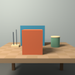
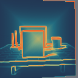

# Evidence Lens

Evidence Lens estimates where a nearby synthesized view is likely to disagree with the scene that produced the input image. Its CPU scorer reads one source image, calibrated cameras and a generator's predicted RGB, opacity and expected camera depth. It produces continuous risk and low, high or unknown decisions for every target pixel.

The fitted L1-full and L1-geometry models, preprocessing, schema and thresholds occupy **12,387 bytes** of JSON. On the four families originally held out, L1-full reached family-equal average precision **0.804** for RGB error and L0 reached **0.402** on the same scoreable pixels. At its frozen threshold, L1-full marked **62.71%** of reference-valid pixels low risk. **11.03%** of those pixels had an actual RGB error. A raw-pixel replay reproduced the operating counts and scores. The separate auxiliary depth comparison found **1.146 m** mean absolute error and **99.40%** above tolerance. The research preview applies to nearby views of opaque synthetic studios with one generator. [Stage-one evidence and limits](docs/phase1/README.md) · [Original study tables](docs/results/README.md)

| Single input | Example projected view | L1-full risk | Low, high or unknown |
| --- | --- | --- | --- |
|  |  |  |  |

The illustration comes from a project-authored textured-plane adapter. Quantitative study results use SHARP and gsplat. [Example inputs and provenance](examples/tabletop-plane/README.md)

## Run the model on a CPU

The local pre-release candidate is `v0.1.1-rc.1` (wheel `0.1.1rc1`). Public distribution awaits the owner's repository and terms. Its ZIP contains the fitted model, source modules, seven small predictions, all six expected target results and an independent smoke command. After verifying the ZIP against its sidecar, extract it and run this command inside the extracted folder using Python 3.11 or later.

```sh
python -I smoke.py --output ../evidence-lens-grade
```

On Windows, use `py -3 -I smoke.py --output ..\evidence-lens-grade`. The command creates a clean environment and installs the CPU wheel with NumPy and Pillow. Open the first target's risk and state PNGs under the output's `maps/` directory. Each run needs a fresh output directory. The included 128 × 128 textured plane checks numerical parity with the original deployment example. The scientific evaluation uses six 512 × 512 target views per family. To install the CPU implementation from a checkout, use `python -m pip install .`. [RC installation instructions](docs/releases/v0.1.1-rc.1/README.md) · [Prediction contract](docs/cpu-scoring.md)

## Study and tested scope

The study uses 24 procedural families of static, opaque objects. Blender 4.5.16 LTS Cycles on an arm64 Mac rendered reference RGB, positions and camera-axis depths. SHARP commit `aed6527499ef91cba3b54c18d49a870f25947190` with the checkpoint starting `94211a75198c47f6` produced one Gaussian scene per input. On Windows 11 with an RTX 3060 Laptop, gsplat 1.5.3 rendered the source and six nearby targets using expected optical-axis depth in metres. The first engineering input produced 1,179,648 Gaussians in a 14.81-second forward pass. CPU installation checks and the GPU geometry probes have separate receipts. The baseline measurements use the frozen RGB label of mean absolute display-sRGB error strictly greater than 0.05. [Deployment validation and scientific case scope](docs/phase1/README.md)

L1-full and L1-geometry are L2-regularized logistic regressions fitted on the same 393,216 sampled target pixels. The 16 training families are the independent training units. Four separate development families set the low-risk operating thresholds. Four further families were held out until the model and metric code were frozen. The experiment covers baseline inputs, half-resolution inputs and a round-trip of only the Gaussian colour coefficients through binary16. Real photographs, transparent materials, moving scenes and other learned generators fall outside the measured scope. The candidate smoke records the exact operating system, wheel and dependencies in a separate receipt. [Candidate model card](docs/releases/v0.1.1-rc.1/MODEL_CARD.md) · [Study protocol](protocol/study-v1.json)

The engineering tabletop remains a reproducible failure case. Its six targets contained 416,365 RGB errors among 1,572,864 comparable pixels. L0 flagged 27.82% of those errors. Among pixels labelled low risk, 21.54% exceeded the RGB error threshold. That family belongs to training. It is reported separately from held-out performance.

## Reproduce the research

The authored recipes, cameras, family split, feature specification, labels and fitting protocol are in the repository. Follow the reconstruction guide to make a new research store, render a family, run the Windows worker and fit a replication model. Full original arrays, Gaussian files, logs and the live database are kept in the research archive. Public run IDs, manifests and checksums identify their origins. The scoring entry point takes only source and prediction inputs. The independent evaluation entry point reads target references.

- [Rebuild from a fresh checkout](docs/rebuild-study.md) describes environment setup, the single-family pilot and a separate full replication.
- [Module inputs, outputs and permissions](docs/data-contract.md) identifies each producer and its permitted data.
- [Blender reference validation](docs/blender-reference.md) and [Windows GPU acquisition](docs/windows-worker.md) document the coordinate and rendering conventions.
- [Recording, transfer and restore](docs/recording.md) documents immutable attempts, failed runs, local indexing and archive checks.
- [L1 training](docs/l1-training.md) and [formal evaluation](docs/formal-evaluation.md) specify sampling, family folds, thresholds, denominators and common-mask comparisons.
- [License and provenance inventory](docs/licenses.md) lists separate terms for original code, fitted parameters, example data and third-party research software.
