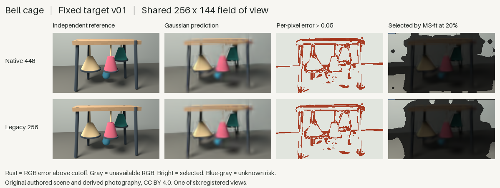

# Bell cage on two analysis grids

Across six views of the same authored bell cage, **35,416 of 221,184 pixels (16.012%)** exceeded the RGB error cutoff in the 448 × 252 prediction reduced to the common viewing grid. The legacy prediction had **34,989 of 221,184 (15.819%)** above the cutoff. Each error label compares one predicted pixel with the independently rendered target at the same position. The four risk models rank pixels within each prediction.

Both routes used the original four-source Gaussian checkpoint and the same physical target poses. After all 48 route, method and view combinations had sealed scores, Blender 4.5.16 LTS rendered the six independent 896 × 504 FP32 display-sRGB target images with Cycles on CPU at 96 samples per pixel. This is a descriptive engineering comparison on one previously studied synthetic scene. [Full evidence and parent identities](bell-comparison.json)

## Matching the field of view

The native route scored a 448 × 252 frame. The legacy route scored a 256 × 256 frame with 256 × 144 image content in rows 56 through 199. The upper and lower bands account for 172,032 unknown pixels across the six legacy canvases. At their own content resolutions, the native prediction had 110,553 errors among 677,376 pixels (16.321%) and the legacy prediction had 34,989 among 221,184 (15.819%).

For the common 256 × 144 view, the evaluator averaged the original FP32 reference over exact pixel areas. It applied the same rule to the native prediction and removed the legacy padding. The mean absolute difference of the three FP32 display-sRGB channels had to exceed 0.05 for a pixel to count as an error. Native scores, finite masks, states and unknown reasons used the nearest analysis pixel centre. The maximum difference between the routes' transformed intrinsics and the independent camera was below 1.43 × 10⁻¹⁴ pixels. All six camera poses matched. [Per-view populations and unknown reasons](per-view-populations.csv)

## Comparing equal selections

The eight route and model combinations shared 217,547 finite, labelled positions out of 221,184 (98.36%) on the common grid. Before risk selection, the native prediction had 35,358 errors on those positions (16.253%) and the legacy prediction had 34,934 (16.058%). Each model selected its lowest-risk pixels per view. The 10% and 20% quotas used the floor of the eligible count in that view. Ties followed row-major pixel order.

| Model | Native errors among lowest 10% | Legacy errors among lowest 10% | Native errors among lowest 20% | Legacy errors among lowest 20% |
|---|---:|---:|---:|---:|
| B-L1-transfer | 2,056 / 21,753 | 1,193 / 21,753 | 4,034 / 43,507 | 2,082 / 43,507 |
| MS-L1 | 58 / 21,753 | 52 / 21,753 | 126 / 43,507 | 89 / 43,507 |
| MS-frozen | 0 / 21,753 | 0 / 21,753 | 0 / 43,507 | 13 / 43,507 |
| MS-ft | 0 / 21,753 | 0 / 21,753 | 0 / 43,507 | 1 / 43,507 |

The 20% selection covered 19.67% of the full common canvas. Both visual models selected zero high-error native pixels at this quota. Both linear models selected fewer high-error pixels on the legacy route. The tables retain each method's own native eligible area, the four-method intersection, each pair of corresponding routes and the shared eight-way intersection. Selection hashes and per-view counts support direct checks of ties and rounding. [Aggregated selections](coverage.csv) · [Per-view selections](per-view-coverage.csv)

| Grid and method | Unknown / own content pixels | Unknown / common canvas pixels | Six-view file score wall time | Process CPU time | Peak RSS through file scoring |
|---|---:|---:|---:|---:|---:|
| Native B-L1-transfer | 0 / 677,376 | 0 / 221,184 | 0.362 s | 0.362 s | 130.0 MiB |
| Native MS-L1 | 10,933 / 677,376 | 3,567 / 221,184 | 0.640 s | 0.639 s | 264.5 MiB |
| Native MS-frozen | 10,933 / 677,376 | 3,567 / 221,184 | 1.752 s | 2.199 s | 484.5 MiB |
| Native MS-ft | 10,933 / 677,376 | 3,567 / 221,184 | 1.761 s | 2.204 s | 484.2 MiB |
| Legacy B-L1-transfer | 0 / 221,184 | 0 / 221,184 | 0.162 s | 0.162 s | 90.2 MiB |
| Legacy MS-L1 | 3,584 / 221,184 | 3,584 / 221,184 | 0.322 s | 0.321 s | 144.9 MiB |
| Legacy MS-frozen | 3,584 / 221,184 | 3,584 / 221,184 | 1.578 s | 1.777 s | 420.0 MiB |
| Legacy MS-ft | 3,584 / 221,184 | 3,584 / 221,184 | 1.520 s | 1.669 s | 403.5 MiB |

These Mac measurements cover file scoring, including model loading, source decoding and writing six score products. Peak RSS is the process high-water mark at file completion and includes earlier bundle validation. The visual models used four CPU threads. The resource table also records the later process peak after HTML generation and both resident cache modes. [Scoring resources](scoring-resources.csv) · [Aggregate populations](populations.csv)



The figure shows target v01, selected in advance. Bright pixels in the final column are members of the shared-domain 20% selection. Attribution for the authored scene, photographs and derived figure is **wany614, Evidence Lens**. [CC BY 4.0](https://creativecommons.org/licenses/by/4.0/)

## Reproduction

The evaluation program was frozen in run `20261124T104725823548Z-ae3cfab9e9044b6c`. The score opening binds the two deployment archives. The independent references link back to that opening and the original scene and cameras. To reproduce in a recorder store with these parent runs, use the package-data launcher.

```sh
PYTHONPATH=src:scripts python scripts/v05_bell_evaluation_runtime.py evaluate --store /path/to/dual-track-v1
```

The final result was sealed as `20261124T105844729451Z-fef3e06c7c18437f` with manifest SHA-256 `f7a7396827ad7554173c813fcf43b246a4425d64fd485da992cd4e8ecf090c8b`. The first execution stopped while loading a JSON model profile omitted by the recorder's Python source snapshot. The recorder rejected a changed command under its original retry identity. The successful execution explicitly supplied the existing content-addressed release profile and ran the frozen evaluator. Both earlier attempts, their manifests and their dispositions are recorded. [Runtime recovery](runtime-recovery.json)
