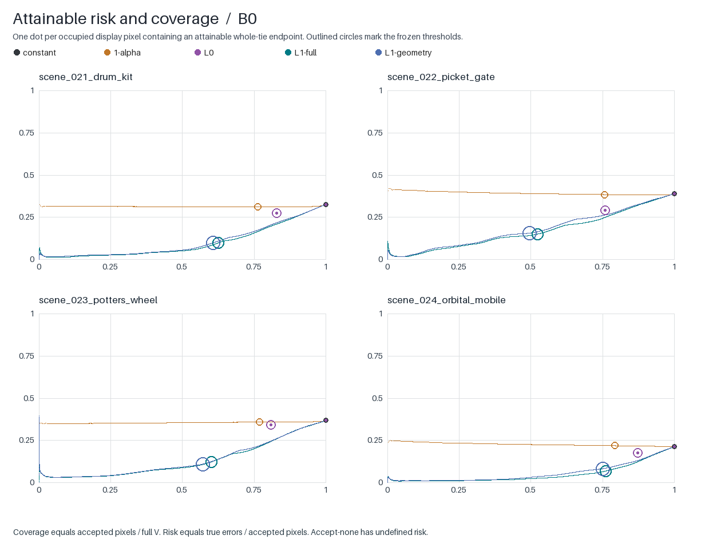
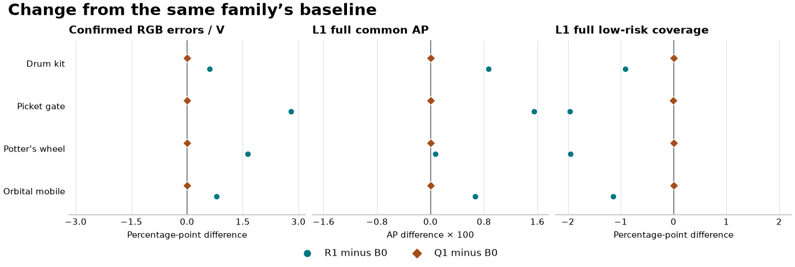

# Which pixels in a new view can we trust?

On four held-out scenes, L1 full ranked pixels by the risk of an RGB reconstruction error with an average precision (AP) of **0.804** under the baseline condition. The highest AP among the three simple baselines was 0.402 (L0 rule).

At the frozen B0 threshold, L1 full accepted **80.00%** of reference-valid pixels as low risk on the four development families. **6.47%** of accepted pixels were errors. On the four held-out families, coverage was **62.71%** and the error rate among accepted pixels was **11.03%**. Both metrics give eligible families equal weight.

Each scene starts from one image. Apple’s SHARP estimates a Gaussian scene representation. gsplat renders six new camera views, and Blender supplies independent reference images. An error is a mean absolute RGB channel difference greater than 0.05 on a display-sRGB scale from 0 to 1. The study assigned 16 original, static, opaque scene families to training, 4 to development and 4 to testing. The development families set the decision thresholds. Performance on real photographs and other generators is unmeasured. [Study protocol](../../protocol/study-v1.json)

## Render quality

B0 used a 512 × 512 input. R1 reduced it to 256 × 256 before generation. Q1 reused the B0 scene and rounded its colour coefficients through FP16. All conditions evaluated the same six cameras per test family at 512 × 512.

| Condition | Completed targets | Errors / valid prediction % | Confirmed errors / reference % | Invalid output / reference % | Common ranking pixels / reference % |
| --- | --- | --- | --- | --- | --- |
| B0 | 24/24 | 32.5 | 32.5 | 0.0 | 99.7 |
| R1 | 24/24 | 33.9 | 33.9 | 0.0 | 99.3 |
| Q1 | 24/24 | 32.5 | 32.5 | 0.0 | 99.7 |

The reference population **V** contains all pixels with valid reference RGB. **E** also requires valid predicted RGB. Confirmed errors **Y** are defined on E. The common ranking set **S** contains the pixels in E that all five methods can score. Percentages pool pixels across each family’s cameras first, then give every eligible family equal weight.

The B0 counts below sum pixels across all four families. The share of E divides the region’s evaluable pixels by all evaluable pixels in that family. Error incidence divides errors in the region by evaluable pixels in that same region. Each percentage gives eligible families equal weight.

| B0 visibility region | Errors (Y) | Evaluable pixels (E) | Share of E % | Within-region errors / E % | Families with region E |
| --- | --- | --- | --- | --- | --- |
| All evaluable pixels | 2,043,247 | 6,291,456 | 100.00 | 32.48 | 4/4 |
| Visible in the source view | 1,830,064 | 5,524,385 | 87.81 | 33.14 | 4/4 |
| Revealed by a target view | 142,236 | 391,012 | 6.21 | 36.23 | 4/4 |
| Outside the source field of view | 70,946 | 376,058 | 5.98 | 19.18 | 4/4 |
| Background or invalid reference geometry | 1 | 1 | <0.01 | 100.00 | 1/4 |

Surfaces revealed by a target view were occluded in the source. The mean within-family difference in error incidence, revealed minus visible, was +3.09 percentage points across 4 families with both regions.

## Ranking and the low-risk decision

L1 geometry uses camera, depth and opacity features. L1 full also uses appearance differences. The baselines are the training-family error prior, one minus predicted opacity, and L0’s fixed geometric rule. Higher AP means that true errors receive higher scores. For the four methods with development-selected thresholds, the operating point was the attainable coverage nearest to 80%, keeping equal scores together. The constant prior assigns every scored pixel to one tie group. L0 retained its 0.5 decision boundary.

| Condition | Method | Common AP | AP families · views | Low / V % | Errors / low % | Families with low pixels | Unknown / E % |
| --- | --- | --- | --- | --- | --- | --- | --- |
| B0 | Constant prior | 0.323 | 4/4 · 24/24 | 100.0 | 32.5 | 4 | 0.0 |
| B0 | 1 − alpha | 0.355 | 4/4 · 24/24 | 77.0 | 31.8 | 4 | 0.0 |
| B0 | L0 rule | 0.402 | 4/4 · 24/24 | 81.7 | 27.0 | 4 | 0.0 |
| B0 | L1 geometry | 0.771 | 4/4 · 24/24 | 60.6 | 11.2 | 4 | 0.3 |
| B0 | L1 full | 0.804 | 4/4 · 24/24 | 62.7 | 11.0 | 4 | 0.3 |
| R1 | Constant prior | 0.335 | 4/4 · 24/24 | 100.0 | 33.9 | 4 | 0.0 |
| R1 | 1 − alpha | 0.399 | 4/4 · 24/24 | 76.2 | 32.0 | 4 | 0.0 |
| R1 | L0 rule | 0.408 | 4/4 · 24/24 | 81.0 | 28.4 | 4 | 0.0 |
| R1 | L1 geometry | 0.768 | 4/4 · 24/24 | 58.9 | 11.7 | 4 | 0.7 |
| R1 | L1 full | 0.812 | 4/4 · 24/24 | 61.2 | 11.3 | 4 | 0.7 |
| Q1 | Constant prior | 0.323 | 4/4 · 24/24 | 100.0 | 32.5 | 4 | 0.0 |
| Q1 | 1 − alpha | 0.355 | 4/4 · 24/24 | 77.0 | 31.8 | 4 | 0.0 |
| Q1 | L0 rule | 0.402 | 4/4 · 24/24 | 81.7 | 27.0 | 4 | 0.0 |
| Q1 | L1 geometry | 0.771 | 4/4 · 24/24 | 60.6 | 11.2 | 4 | 0.3 |
| Q1 | L1 full | 0.804 | 4/4 · 24/24 | 62.7 | 11.0 | 4 | 0.3 |

Common AP averages only cameras containing both error classes on S, then averages their family means. A dash marks an undefined quantity. A pixel enters the low-risk set **L** when its score is strictly below the threshold. Coverage divides L by full V. Accepted risk divides confirmed errors in L by L. Missing predictions remain in V. Unknowns stay outside L.

### The same four families

Each cell gives **common AP / low-risk coverage (%)**. The view count gives the number of the six targets eligible for common-mask AP. Exact pixel counts, high and unknown states, own-mask AP and thresholds are in the downloadable table. [Family and method counts](family-methods.csv)

| Family | Condition | AP views | Constant prior | 1 − alpha | L0 rule | L1 geometry | L1 full |
| --- | --- | --- | --- | --- | --- | --- | --- |
| Drum kit | B0 | 6/6 | 0.324 / 100.0 | 0.382 / 76.3 | 0.400 / 82.8 | 0.820 / 60.7 | 0.846 / 62.5 |
| Drum kit | R1 | 6/6 | 0.329 / 100.0 | 0.408 / 75.2 | 0.409 / 82.8 | 0.820 / 59.7 | 0.854 / 61.6 |
| Drum kit | Q1 | 6/6 | 0.324 / 100.0 | 0.382 / 76.3 | 0.400 / 82.8 | 0.820 / 60.7 | 0.846 / 62.5 |
| Picket gate | B0 | 6/6 | 0.388 / 100.0 | 0.420 / 75.6 | 0.524 / 75.9 | 0.738 / 49.5 | 0.773 / 52.3 |
| Picket gate | R1 | 6/6 | 0.411 / 100.0 | 0.506 / 74.7 | 0.525 / 75.1 | 0.741 / 47.3 | 0.788 / 50.3 |
| Picket gate | Q1 | 6/6 | 0.388 / 100.0 | 0.420 / 75.6 | 0.524 / 75.9 | 0.738 / 49.5 | 0.773 / 52.3 |
| Potter’s wheel | B0 | 6/6 | 0.367 / 100.0 | 0.410 / 76.8 | 0.396 / 80.9 | 0.822 / 57.1 | 0.828 / 60.0 |
| Potter’s wheel | R1 | 6/6 | 0.378 / 100.0 | 0.456 / 75.4 | 0.408 / 79.9 | 0.820 / 55.0 | 0.829 / 58.1 |
| Potter’s wheel | Q1 | 6/6 | 0.367 / 100.0 | 0.410 / 76.8 | 0.396 / 80.9 | 0.822 / 57.1 | 0.828 / 60.0 |
| Orbital mobile | B0 | 6/6 | 0.214 / 100.0 | 0.208 / 79.3 | 0.291 / 87.1 | 0.704 / 75.1 | 0.768 / 76.0 |
| Orbital mobile | R1 | 6/6 | 0.222 / 100.0 | 0.224 / 79.6 | 0.291 / 86.3 | 0.692 / 73.5 | 0.775 / 74.9 |
| Orbital mobile | Q1 | 6/6 | 0.214 / 100.0 | 0.208 / 79.3 | 0.291 / 87.1 | 0.704 / 75.1 | 0.768 / 76.0 |

The horizontal axis is accepted pixels divided by V. The vertical axis is errors among accepted pixels. Each plotted location contains at least one attainable whole-score-tie group. Outlined circles mark frozen operating points with at least one accepted pixel. [R1 risk and coverage](../../examples/study-figures/risk-coverage-R1.png) · [Q1 risk and coverage](../../examples/study-figures/risk-coverage-Q1.png)

## Paired changes

The preregistered R1 outcome measures confirmed errors over all V. Reducing input resolution changed that rate by **+1.46 percentage points** across 4 matched families. L1 full’s matched common AP changed by +0.008 and its low-risk coverage by -1.49 percentage points. The AP differences pair cameras eligible in both conditions. Coverage uses the whole planned family population.

The constant prior’s common-mask AP was 0.323 under B0 and 0.335 under R1. Its AP equals the error prevalence on each eligible camera’s common mask. The L1 AP change is unadjusted for this shift in prevalence. [Paired numerical changes](paired-changes.csv) · [Registered intervention](../../protocol/analysis-addendum-v1.json)

| Family | B0 Y/V % | R1 Y/V % | R1 change (pp) | Matched AP views | R1 change in L1 full AP | R1 coverage change (pp) |
| --- | --- | --- | --- | --- | --- | --- |
| Drum kit | 32.6 | 33.2 | +0.60 | 6/6 | +0.009 | -0.92 |
| Picket gate | 39.0 | 41.8 | +2.79 | 6/6 | +0.016 | -1.96 |
| Potter’s wheel | 36.9 | 38.5 | +1.64 | 6/6 | +0.001 | -1.95 |
| Orbital mobile | 21.4 | 22.2 | +0.79 | 6/6 | +0.007 | -1.14 |

### Colour precision

Q1 compares the rounded-colour render with the original B0 render. RGB changes are absolute three-channel means per jointly valid pixel. L1 full score changes use jointly finite scores. The last two columns count views with byte-identical geometry fields and individual full scores whose stored bits changed.

| Family | Paired views | Mean RGB change | Largest pixel RGB change | Mean L1 score change | Largest L1 score change | Geometry identical | Changed L1 scores |
| --- | --- | --- | --- | --- | --- | --- | --- |
| Drum kit | 6/6 | 1.101e-05 | 1.097e-04 | 1.553e-05 | 8.013e-04 | 6/6 | 1,558,356 |
| Picket gate | 6/6 | 1.144e-05 | 1.128e-04 | 1.967e-05 | 9.902e-04 | 6/6 | 1,550,707 |
| Potter’s wheel | 6/6 | 1.090e-05 | 1.051e-04 | 1.569e-05 | 8.699e-04 | 6/6 | 1,558,808 |
| Orbital mobile | 6/6 | 9.186e-06 | 9.179e-05 | 1.166e-05 | 8.352e-04 | 6/6 | 1,569,747 |

RGB changed on 6,275,700 of 6,291,456 paired target pixels. In the separate source-view diagnostic, geometry was byte-identical for 4/4 available families. These counts exclude unavailable pairs.

## Completion, cost and recovery

**72/72 held-out target renders completed.** The run roster contains 269 stage records. Of these, 1 ended unsuccessfully (1 engineering scene render) and 0 have an explicit retry link. Stage attempts and held-out target completion have different denominators.

The engineering entry `20261123T023207417771Z-b6704c859b094a10` was a deliberate recorder smoke test tagged `scene_render`. Its Python worker exited with code 7 before any Blender rendering.

Median recorded wall time in seconds across the four selected quality families, using each stage’s available receipts. Q1 reuses B0 generation. Generation wall time includes recorder setup, launching a separate worker for each run, loading the model, running prediction and exporting the Gaussian scene.

| Condition | Generation | Preparation | Render | CPU learned scoring | Five-method evaluation |
| --- | --- | --- | --- | --- | --- |
| B0 | 48.84 | — | 7.21 | 1.70 | 5.59 |
| R1 | 48.73 | 0.22 | 6.91 | 1.66 | 5.62 |
| Q1 | reuses B0 | 2.27 | 7.52 | 1.65 | 6.39 |

Dedicated timing runs repeated one preregistered family three times per condition. The following medians use successful repeats. These runs are separate from the quality selection.

| Condition | Stage | Successful repeats | Median s | Minimum s | Maximum s |
| --- | --- | --- | --- | --- | --- |
| B0 | generation | 3/3 | 48.70 | 47.77 | 49.45 |
| B0 | CPU scoring | 3/3 | 1.79 | 1.70 | 1.81 |
| B0 | render | 3/3 | 7.22 | 7.20 | 7.27 |
| R1 | generation | 3/3 | 48.62 | 48.17 | 48.83 |
| R1 | CPU scoring | 3/3 | 1.68 | 1.66 | 1.68 |
| R1 | render | 3/3 | 7.05 | 7.02 | 7.23 |
| Q1 | colour derivation | 3/3 | 2.44 | 2.42 | 2.49 |
| Q1 | CPU scoring | 3/3 | 1.64 | 1.62 | 1.73 |
| Q1 | render | 3/3 | 7.61 | 7.56 | 7.62 |

The listed run bundles total 23.08 GiB in logical member bytes. This includes repeated and staged files. Sampled peak process-tree RSS by platform was Windows 8.85 GiB, macOS 1.39 GiB. The NVIDIA GeForce RTX 3060 Laptop GPU has 6 GiB of dedicated VRAM. Across worker phases, the independent maxima of PyTorch’s CUDA allocator counters were 6.89 GiB allocated and 11.04 GiB reserved. Physical GPU memory residency was unmeasured.

The sealed inventory contains the following recovery, archive or transfer checks. Ranges are per receipt so repeated inspections of an archive do not inflate totals.

| Receipt kind | Recorded measurement | Receipts | Observed value or range |
| --- | --- | --- | --- |
| Archive | download seconds | 24 | 8.90–17.96 |
| Recovery | compared files | 1 | 21 |
| Recovery | download seconds | 1 | 11.00 |
| Recovery | index receipts | 1 | 24 |
| Recovery | logical files | 1 | 896 |
| Recovery | verified runs | 1 | 10 |

## Evidence and reproduction

The fitted model used 393,216 sampled training pixels, including 120,458 errors. The method commit is `cf72c00c555929ab55ea372dca4e98b6504a8721`. Training run `20261123T042239692597Z-0616eff18c3149a7` produced the coefficients. Development run `20261123T042819219876Z-27eaa01eba29489d` froze the thresholds. Report run `20261123T050620457525Z-a311c1632b7d4b1b` produced the sealed aggregates. [Source digests and figure inventory](provenance.json)

The source checkout contains the two numerical tables linked above and all four aggregate plots. Regeneration uses the pinned recorder archive with NumPy, Pillow and Matplotlib. Inside the matching **model ZIP**, `results/family-results.csv` holds the full region tables, `results/paired-family-equal.csv` holds paired family summaries, and `model/thresholds.json` contains the exact decisions. [Evaluation definitions](../formal-evaluation.md) · [Study reconstruction](../rebuild-study.md) · [Release contents](../model-release.md)
