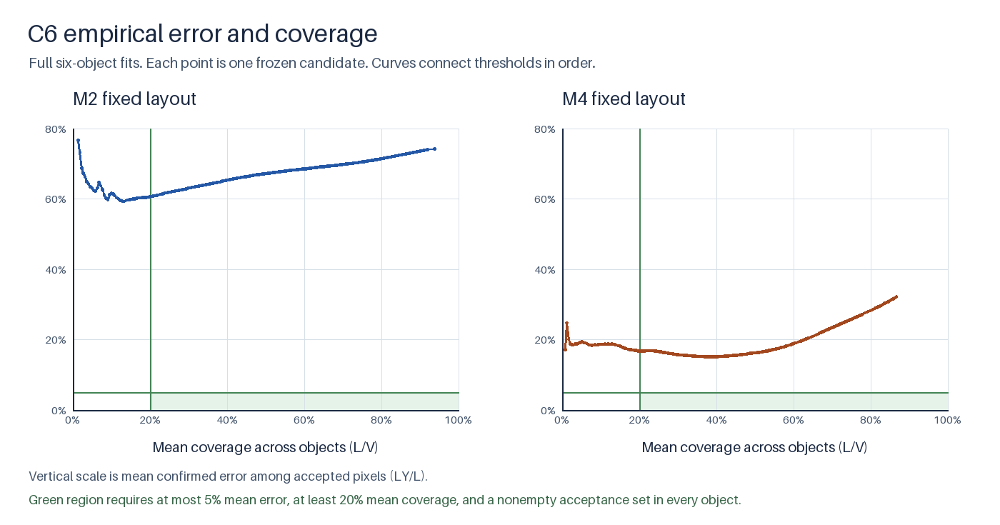

# C6 empirical operating points

Six physical objects supplied calibration labels for each fixed layout. The same six objects contribute to both layouts. The released MS-L1 score, 39 feature columns and valid/unknown decisions were fixed before C6. A pixel is a confirmed error when its mean absolute display-sRGB discrepancy exceeds 0.05. The empirical operating target requires mean accepted-pixel error at most 5%, mean coverage at least 20%, and at least one accepted pixel in every object. [Cohort and acquisition](../cohort/README.md) · [Frozen algorithm](calibration-method.json)

| Layout | Profile status | Selected mean coverage | Selected mean error | Lowest mean error at ≥20% coverage | Coverage at that diagnostic point | Feasible training folds |
| --- | --- | ---: | ---: | ---: | ---: | ---: |
| M2 | `no_feasible_operating_point` | N/A | N/A | 60.69% | 20.36% | 0/6 |
| M4 | `no_feasible_operating_point` | N/A | N/A | 15.15% | 38.19% | 0/6 |

Coverage is L/V and accepted-pixel error is LY/L. Counts pool the six camera views within each object, then the table equally weights the six objects. Empty acceptance gives undefined error. The diagnostic point shown above is one measured point on the full curve. Where fitting produced no feasible operating point, the profile contains a null threshold. The original released MS-L1 cutoff gave M2 29.23% coverage and 62.86% accepted-pixel error and M4 55.11% coverage and 17.29% accepted-pixel error. [Original four-method totals](original-method-family-means.csv) · [Object counts at every candidate](candidate-object-counts.csv)

At the diagnostic points, M2 had its highest object error on set75 (84.19%) and its lowest object coverage on set110 (10.84%). M4 had its highest object error on set42 (20.04%) and its lowest object coverage on set42 (23.78%). [All six objects at both diagnostic points](diagnostic-object-counts.csv)

Each full fit and each leave-one-object-out fit independently formed 201 candidates from the relevant objects’ frozen deployment scores. The six leave-one-object-out fits per layout never used the excluded object's scores or labels to select its threshold. The score-only commitment preceded collective target opening. An independent readback checked all 2,814 candidate cutoffs and 14,472 object-by-cutoff rows against the native predictions, risk maps and registered photographs. [All curves](candidate-curves.csv) · [All 12 held-out evaluations](leave-one-out.csv) · [Independent readback](calibration-audit.json)

The two profiles apply to the registered fixed M2 or M4 layout, the frozen reconstruction recipe and gsplat 1.5.3. C6 supplies empirical calibration evidence. T1 remains unevaluated here. Models, thresholds and domains for earlier roles retain their published identities. The numerical evidence supplies no probability calibration or cross-asset guarantee. [M2 profile](profiles/M2.json) · [M4 profile](profiles/M4.json) · [Numerical provenance](public-evidence.json)
