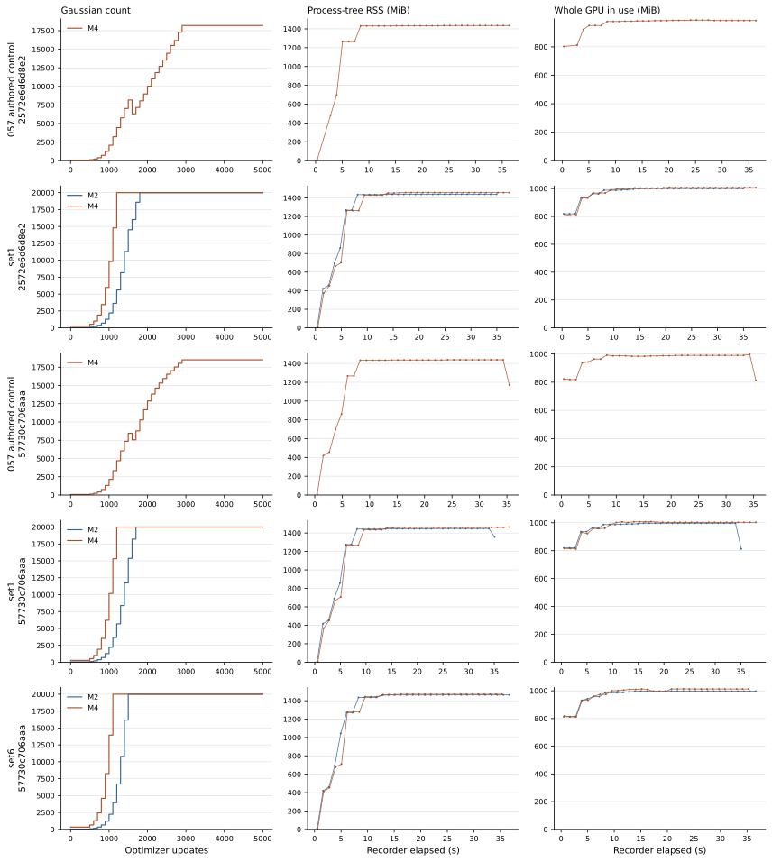

# Reconstruction recovery resource ledger

At 2026-11-23T22:53:10.068876Z, the inventory contained 130 sealed producer records. 122 succeeded and 8 failed. 3 records were in quarantine. The [closure](closure.json) and [complete original list](runs-including-ledger.csv) add the resource report's own final seal, duration and memory.

## Gaussian optimization

| Object | Sources | Recipe SHA prefix | Processes | Updates across attempts | Largest step | Initial points | Peak points | Points at largest step |
|---|---|---|---:|---:|---:|---:|---:|---:|
| scene_057_offset_bell_cage | M4 | 2572e6d6d8e2 | 1 | 5000 | 5000 | 66 | 18202 | 18202 |
| scene_057_offset_bell_cage | M4 | 57730c706aaa | 1 | 5000 | 5000 | 66 | 18508 | 18508 |
| set1 | M2 | 2572e6d6d8e2 | 1 | 5000 | 5000 | 52 | 20000 | 20000 |
| set1 | M4 | 2572e6d6d8e2 | 1 | 5000 | 5000 | 271 | 20000 | 20000 |
| set1 | M2 | 57730c706aaa | 1 | 5000 | 5000 | 52 | 20000 | 20000 |
| set1 | M4 | 57730c706aaa | 1 | 5000 | 5000 | 271 | 20000 | 20000 |
| set6 | M2 | 57730c706aaa | 1 | 5000 | 5000 | 46 | 20000 | 20000 |
| set6 | M4 | 57730c706aaa | 1 | 5000 | 5000 | 333 | 20000 | 20000 |

[Fit cells](fit-cells.csv) identify each object, source condition, recipe and contributing process. [Per-process costs](fit-costs.csv) retain continuation origins, loop times and partial logs. [Per-update measurements](fit-steps.csv.gz) give the selected source, cumulative source counts, loss, phase and population. [Topology events](topology-events.csv) record each capacity decision and the Adam moment check for each mutation. [Issued checkpoints](fit-checkpoints.csv), [rendered checkpoints](render-checkpoints.csv) and [Mac checkpoint audits](checkpoint-audits.csv) identify the original bytes and sampler or optimizer readbacks.

## Timing, memory and storage

The [stage table](stages.csv) groups individual recorder durations by producer and operation. Work on two machines can overlap. Per-run worker, optimizer-loop and watchdog clocks retain their original boundaries. The [telemetry samples](telemetry.csv.gz) contain process-tree RSS, whole-device GPU memory and per-process GPU memory where the driver returned it. PyTorch peak allocation and reservation cover the worker process. An empty measurement is unavailable or inapplicable.

Mac physical free space was 31.98 GiB at registration and 30.47 GiB at the inventory cutoff. The lowest recorded Mac write preflight was 30.56 GiB free. The active store contained 12.77 GiB at registration and 13.46 GiB at cutoff. The registered free-space floor was 30.00 GiB and the active-store target was 20.00 GiB. Active logical bytes coalesce hard links within each measurement. Other processes may change available space on the same physical volume.

The Mac verified 34 distinct incoming ZIPs totalling 448,413,525 bytes. [Receiving receipts](transfers.csv) preserve local verification time. [Joined Windows receipts](windows-package-receipts.csv) bind each original dispatch and archive digest. [Exchange files](exchange-files.csv) list each observed handoff and return. [Archive receipts](archives.csv) list recorder archives present at cutoff. The [summary](resources.json) separates provider response bodies, mounted file sizes and unique received ZIPs. Packet-level traffic was unmeasured.

## Readback

The [published member manifest](public-files.json) hashes each generated table and figure. With access to the registered study store, the original resource files can be reproduced from the original inventory using `EL_RUN_ID=RECORDED_LEDGER_ID python3 scripts/recovery_ledger.py export --inventory INVENTORY --store STORE --out NEW_DIRECTORY` in the recorded software environment. The numerical tables support redrawing the figure with `python3 scripts/recovery_fit_curves.py --steps fit-steps.csv.gz --resources telemetry.csv.gz --out output.svg`.

## Source-camera projection readback

The [three-dimensional scale distributions](checkpoint-scales.csv), [source projection distributions](source-projection.csv) and [largest ellipses](extreme-points.csv) identify their original checkpoint tensors and registered recipes. The CPU statistic is the major semiaxis of the local three-standard-deviation ellipse in pixels. The source table separately gives the nearest gsplat forward-pass maximum and its signed update offset. An intersection is geometric and each row index refers to one checkpoint. The optimizer did not record individual point contributions. The [input and measurement proofs](source-extent-proofs.json) bind each zero-update CPU run.

## Historical working-cache retirement

The recorded capacity operation `20261123T222757006875Z-8014f6eb80734bb2` released 2 independently recoverable Stage C transport files, containing 488,547,507 logical bytes and 488,554,496 exclusive APFS bytes. The immediately paired volume readings were 31.02 and 31.47 GiB available. The original producer runs, provider objects and transport receipt were retained.
