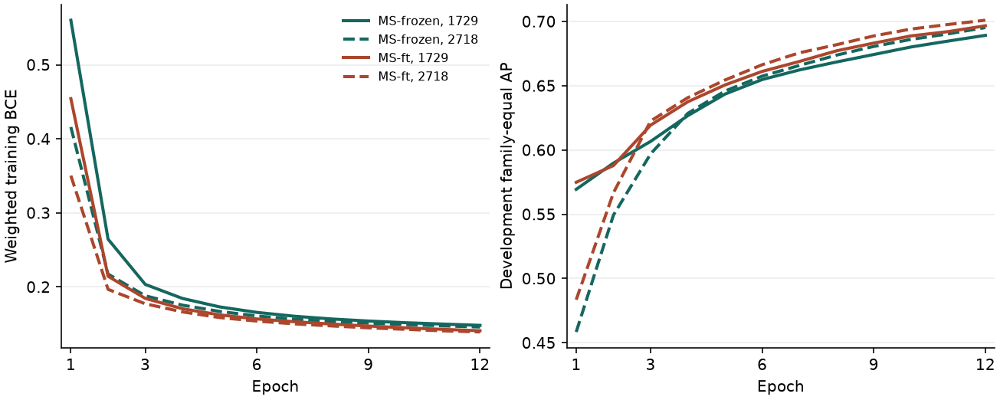

# Stage C learning curves on the original training and development sets

All four fits reached epoch 12, the registered cap, after 288 optimizer updates. Training binary cross-entropy fell and development AP increased at every epoch in all four histories. From epoch 9 to 12 the family-equal AP gain ranged from 0.0122 to 0.0149. Each last-epoch gain was smaller than 0.005. These observations leave performance beyond epoch 12 unmeasured. The frozen deployment decision remains MS-L1. [Original protocol](../../../protocol/stage3-study-v1.json) · [Machine-readable readback](readback.json)

| Method | Seed | Train BCE, epoch 1 → 12 | Development AP, epoch 1 → 12 | AP gain, 9 → 12 | AP gain, 11 → 12 |
| --- | ---: | ---: | ---: | ---: | ---: |
| MS-frozen | 1729 | 0.56014 → 0.14818 | 0.56941 → 0.68920 | 0.01489 | 0.00442 |
| MS-ft | 1729 | 0.45423 → 0.14090 | 0.57488 → 0.69666 | 0.01346 | 0.00452 |
| MS-frozen | 2718 | 0.41591 → 0.14590 | 0.45845 → 0.69527 | 0.01468 | 0.00489 |
| MS-ft | 2718 | 0.35031 → 0.13927 | 0.48352 → 0.70099 | 0.01223 | 0.00332 |

At epoch 12, further backbone fine-tuning increased AP over its paired frozen branch by 0.00745 for the primary seed and 0.00572 for the sensitivity seed. Both branches start from the same Stage B trained backbone with matched new heads and view orders at each seed. All 16 family-by-fit AP means increased between epochs 9 and 12. The increases range from 0.00837 to 0.01866. The two paired seeds and four development families limit conclusions about the effect of extending the optimization budget. [All epochs](epochs.csv) · [All family/condition means](families.csv)

| Development family | Frozen 1729 | FT 1729 | Frozen 2718 | FT 2718 |
| --- | ---: | ---: | ---: | ---: |
| 057 Offset bell cage | 0.69100 | 0.69735 | 0.69129 | 0.69748 |
| 058 Accordion field camera | 0.66530 | 0.67515 | 0.67739 | 0.68605 |
| 059 Offset vane carousel | 0.71012 | 0.71975 | 0.71854 | 0.72544 |
| 060 Tiered sample lathe | 0.69040 | 0.69437 | 0.69385 | 0.69498 |

Each epoch scored the same 48 development targets at score-all. The shared comparison domain contained 3,101,930 finite evaluable pixel positions, including 276,366 high-error RGB events. AP is first computed per target. Six target APs are averaged per acquisition condition, M2 and M4 receive equal weight within each family, and the four families receive equal weight. The readback recomputed 48 fit–epoch macro values from 2,304 recorded view APs, checked their common support and confirmed the earliest maximum in each original training receipt. It used only four signed fit histories and their training summaries. The recovered 1729 frozen package carries the original Windows training curve. [View APs and their denominators](views.csv) · [Readback and plot source](../../../scripts/d0_learning_curves.py)

With Matplotlib installed, run `python3 scripts/d0_learning_curves.py plot --epochs docs/results/stage3-learning-curves/epochs.csv --output curves.png` from the source checkout to redraw the curves. The original readback run is `20261123T193541121397Z-5a3b24cb01b344cb` with manifest SHA-256 `f3339a526a918fb56df960d1d8d6d8f2d9f7a4f2b159e5210680a91cbf9e10dc`. The JSON identifies every input fit, its member hashes, selected epoch and the four output-file hashes.
