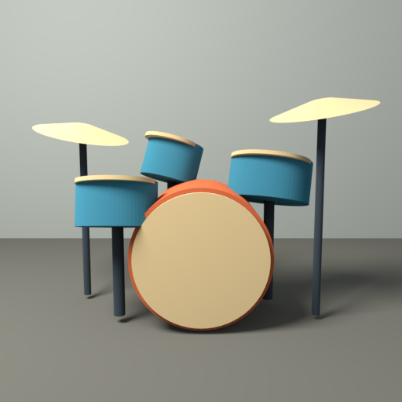
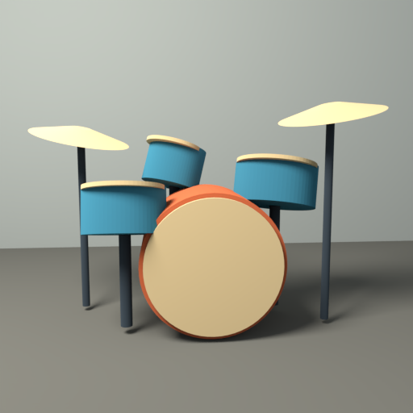

# Drum kit · first held-out target

| Source camera | Target camera v01 |
| --- | --- |
|  |  |

Both images are original 512 × 512 Blender renders from the frozen drum-kit family. The left image was the input to the single-image generator. The right image supplies independent evaluation truth. The PNG files match the original reference run byte for byte. Their SHA-256 and source members are in the [provenance record](provenance.json).

On this target, 73,582 of 262,144 evaluated pixels exceeded the registered RGB-error threshold. The mean absolute difference in display sRGB was 0.08036, and the auxiliary mean absolute camera-depth error was 1.1031 m. The measurements use the archived SHARP prediction. The research archive retains the Gaussian representation and raw predicted arrays. Per-view results for every original held-out family are available in the [diagnostic table](../../docs/phase1/per-view-all.csv).

The formal reference run is `20261123T042832083384Z-a8a2585e6ee541ed`. Credit the original images and text to **wany614** under [CC BY 4.0](https://creativecommons.org/licenses/by/4.0/).
