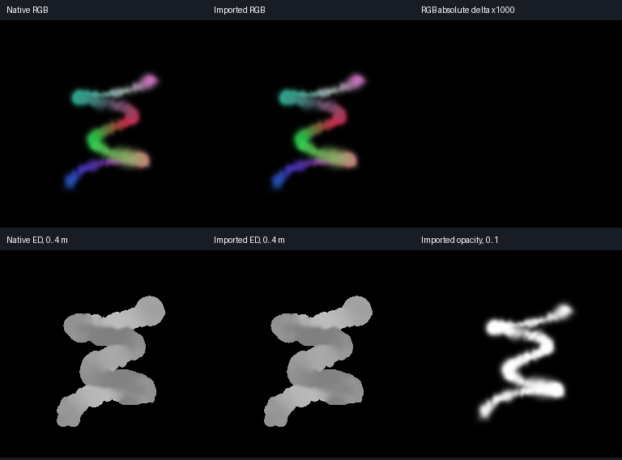

# Helical beads

Open the report to see where two source views support a prediction of this original spiral sculpture. Choose target camera `70`, `109` or `13` to see its predicted image, risk map, model decisions and evidence availability side by side. Each view lists the reasons for unknown pixels. Download the HTML first to use its controls offline. [Open the example report](report.html)

The two source images come from ray intersections with 145 shaded spheres. The predictions come from rendering rotated, partially transparent Gaussians at the same bead centres. The cameras, recorded under their actual COLMAP IDs, use `41` as the primary source and `5` as the other endpoint. This example has no target reference photo from which to measure image error. [Scene generator](../../scripts/b2_asset_fixture.py)

Across the three 256 × 256 targets, MS-L1 returned 33,366 finite scores. Its released threshold classified 1,344 pixels as low risk and 32,022 as high risk. Another 163,242 pixels were unknown. Supplying the published two-source DTU calibration profile to this scene gives `outside_calibration_scope`. All 196,608 raw scores, states, validity flags and unknown reasons agree with the original report. [Report with the DTU profile](outside-scope.html) · [Numerical receipt](../../docs/tooling/assets/verification.json)

In camera `70`, the upper-right panel magnifies the absolute RGB difference by 1,000. The lower-left and lower-middle panels use a 0–4 m expected camera-Z scale. Pixels without opacity appear black there. The lower-right panel shows opacity from 0 to 1. Both render paths used the same CUDA rasterizer. [All 30 numerical comparisons](../../docs/tooling/assets/render-parity.csv)

The portable archive includes the prepared bundle, original asset files, input cameras, two source images, numerical outputs and a CPU wheel. Its SHA-256 is published alongside the reproduction commands. The authored images, renders and reports are licensed under CC BY 4.0. Credit **wany614 / Evidence Lens**. The generator and software are Apache-2.0. [Reproduction instructions](../../docs/tooling/assets/README.md) · [Distribution checksum](../../docs/tooling/assets/portable.json) · [Example file checksums and origins](manifest.json) · [Attribution and license scope](../../docs/tooling/assets/ORIGINAL-EXAMPLE-NOTICE.txt)
