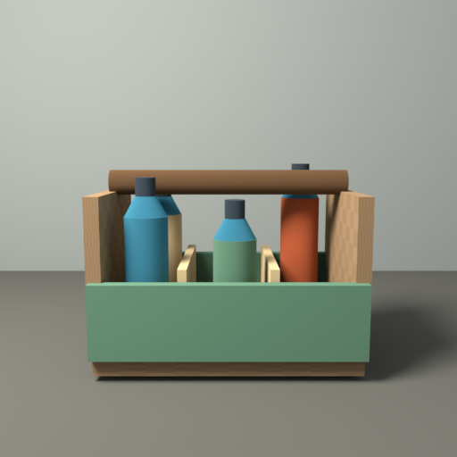
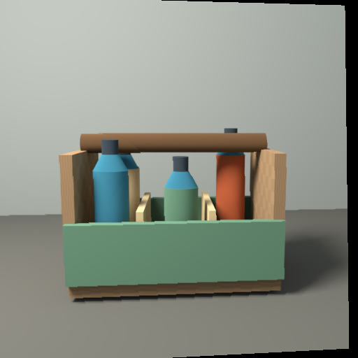
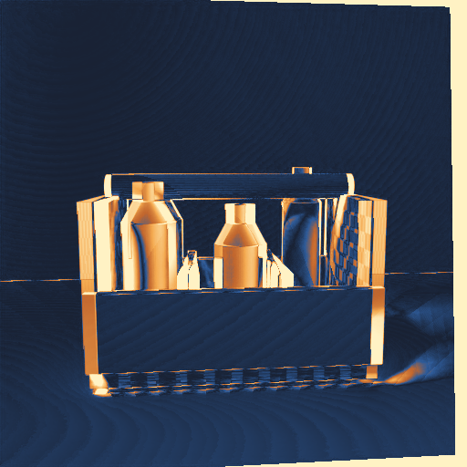
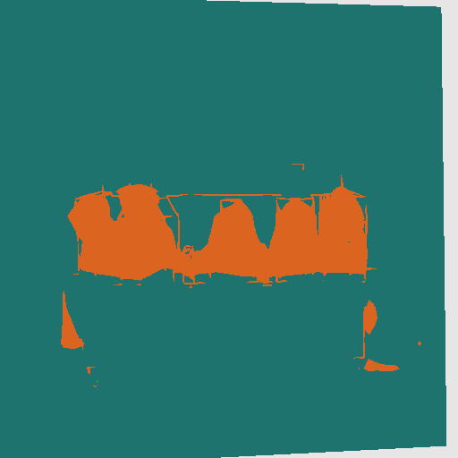

# A native single-image prediction and its measured error

One camera observes a Blender bottle carrier. The example adapter projects that image onto a plane two metres in front of the camera and synthesizes six nearby views. The images below show the preregistered first target. All are 512 × 512 pixels.

| Observed image | Plane prediction at v01 | Measured RGB error | Fine-tuned risk decision |
| --- | --- | --- | --- |
|  |  |  |  |

Across the six targets, 258,620 of 1,572,864 comparable pixels had mean absolute display-sRGB error strictly above 0.05. The fine-tuned scorer assigned 82.83% of reference-valid pixels to low risk. Of the comparable pixels in that group, 5.75% exceeded the error threshold. There were 74,804 unknown pixels. These measurements describe this authored plane on one development family. The SHARP study has its own generator and registered family-level results.

The native control attachment for `v0.2.0-rc.1` contains the source image, camera calibration and seven sets of predicted RGB, optical-axis depth and accumulated alpha in `CASE/`. A separate `REFERENCE/` contains the six original Blender RGB, depth and surface masks for evaluation. The case index SHA-256 is `1323cd8fd285eea2af58133d2b7f63fefed676fd1e44d6eb43e6795ab85a97e0`. The reference index SHA-256 is `07c4fa246d6fb78fb7d59d24817d5a80f5d2311dd256faed77df07f3f0da2715`. [CPU scoring](../../docs/releases/v0.2.0-rc.1/README.md) · [Full reconstruction and evaluation](../../docs/releases/v0.2.0-rc.1/REBUILD.md)

| Origin | Run ID |
| --- | --- |
| Original Blender reference | `20261123T124705616092Z-5739968b93d64b4d` |
| Two-metre plane prediction | `20261123T133630067002Z-4f3c2e0880774b9b` |
| Frozen seven-method CPU scoring | `20261123T141208604123Z-78053c91559d4c98` |
| Independent scored evaluation | `20261123T141310821312Z-fb43e4658dd6465f` |

The authored images, maps and grantable measurements are distributed under CC BY 4.0 with credit to wany614. The independent evaluation and scoring software use Apache-2.0. [Asset licenses and origins](../../licenses/vision-assets.json)
