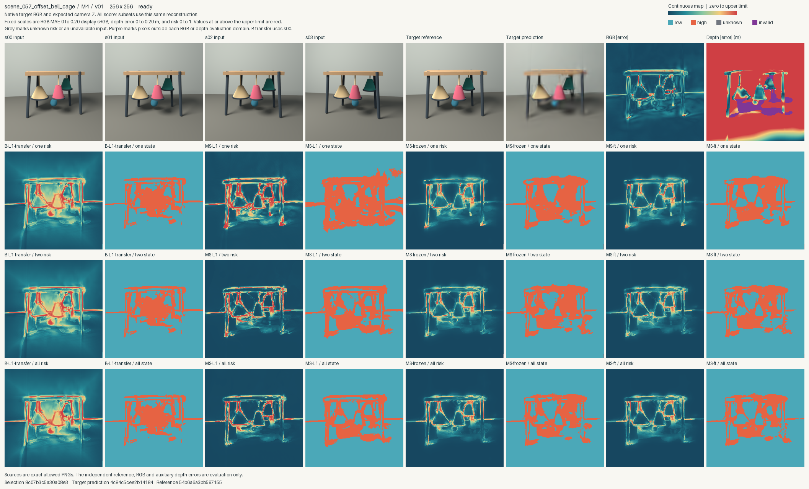
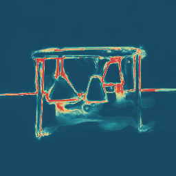
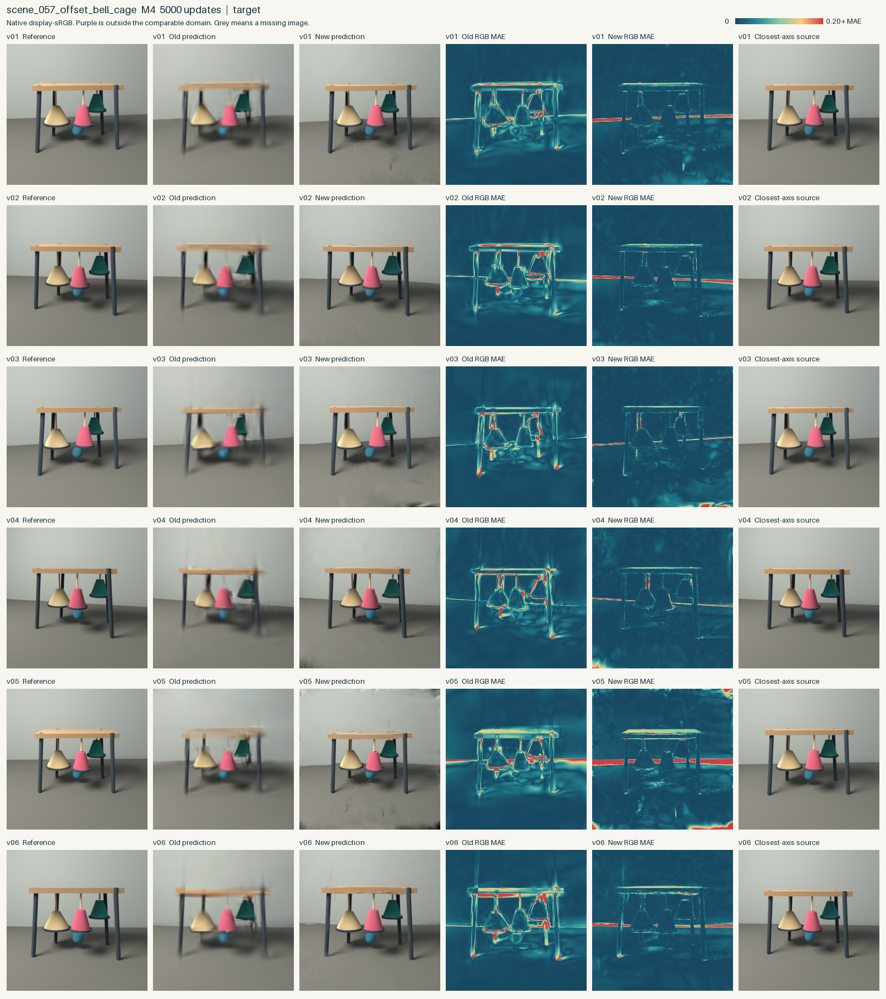

# Offset bell cage

Family 057 is the first registered development family. The four-image reconstruction optimized a single Gaussian scene against four calibrated RGB images. The two-image reconstruction used the same endpoint cameras. Six other cameras provided the fixed target views. The public example ZIP includes both source sets and all six predicted views for each condition. [Download the example and CPU models](https://github.com/wany614/evidence-lens/releases/tag/v0.3.0-rc.1)

The top row contains the source images, target reference, target prediction, absolute RGB error and auxiliary depth error. Each subsequent row keeps the four-image reconstruction fixed and varies the inputs to the scorer. Each method occupies two columns for risk and decision. On this target, all 65,536 pixels were RGB-evaluable and 5,149 exceeded the fixed 0.05 mean absolute display-RGB error threshold. The visual scale for depth error is in metres. Gray denotes missing or unsupported evidence and purple marks pixels outside the indicated evaluation domain.

Each panel preserves its native 256 × 256 pixel grid. A recorded display correction replaced missing font glyphs and checked all 312 panels across the twelve development boards against original numerical files. The CC BY 4.0 images are credited to wany614. [Original member hashes and run IDs](origins.json) · [Published asset rights](../../docs/multisource-rights.md)

## Default model output from the public download

The anonymous macOS run scored the four-source case with MS-L1. The panels below are its original 256 × 256 PNGs. On the state map, teal marks low risk, orange marks high risk and gray marks unknown. The risk map keeps the continuous score. [Anonymous CPU verification](../../docs/verification/v0.3.0-rc.1/README.md)

| Continuous risk | Frozen low, high and unknown states |
| --- | --- |
|  |  |

## Recovery control on the same six cameras

The later reconstruction study fitted the four original source images with source-only triangulation and a density-changing optimizer. Each row below shows a target reference, the historical prediction, the 5,000-update scale-decay prediction, both native RGB error maps and the nearest-axis source copy. Across all six views, mean absolute RGB error fell from 0.01755 to 0.01118. The floor–wall boundary remains displaced on several views. The development selection on DTU independently chose this same recipe and stop step. [Reconstruction results and limits](../../docs/results/reconstruction-recovery/README.md) · [CPU replay and separate CUDA commands](../../docs/recovery-reproduction.md)

This CC BY 4.0 board is credited to wany614. Its original run is `20261123T223026228851Z-2f9bd130b3d44994`, member `payload/boards/target-5000.png`, SHA-256 `22686c84d282142c6e7155c8b5cea6425d2c1322e2e0c998bcd2ec6defcba58b`.
