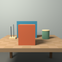
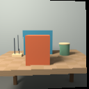

# Tabletop plane example

The camera file describes one input and six nearby target views. The image is a downsample of the project's first procedural Blender scene. The CPU example adapter in `scripts/example_plane.py` uses this image as a texture on one opaque plane at a hypothesized camera depth of two metres. It produces RGB, camera-Z and accumulated opacity by ray–plane intersection. The adapter reads only the source image and cameras. Its output illustrates the inference interface outside the generator used in the formal study.

The model release supplies the derived seven-view arrays, expected numerical scores and grading commands. The original scene render is `20261123T023609071040Z-9fad7aa54fc84008`. The example derivation is `20261123T034606860802Z-acb5e6955f424043`. The accompanying provenance file identifies the source PNG and camera hashes.

| Source | Plane prediction for v01 | L1-full risk for v01 | Frozen decision |
| --- | --- | --- | --- |
|  |  |  |  |

Teal denotes low risk, orange denotes high risk and grey denotes unknown in the decision image. The continuous map uses the same 0–1 scale in every view. The preview manifest binds the displayed PNGs to the scored data and the frozen model. To reproduce all six views, run the release example and export its scores with `python -m evidence_lens.score_maps --scores grade/scores --output maps`.

The original image, camera records, plane predictions and risk-map previews are available under CC BY 4.0. Credit Evidence Lens and wany614 if you share them, link the license and indicate your changes. The plane adapter is available under Apache-2.0. [Example terms](../../licenses/EXAMPLE-LICENSE.txt) · [Software license](../../LICENSE)
